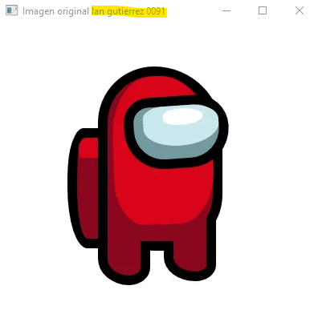
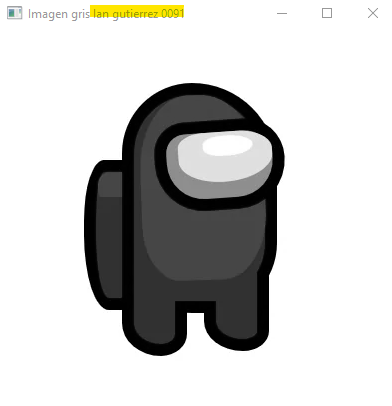
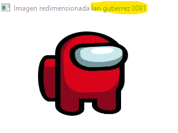
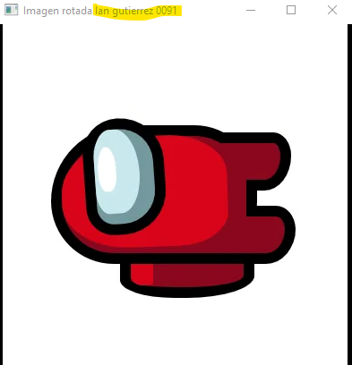
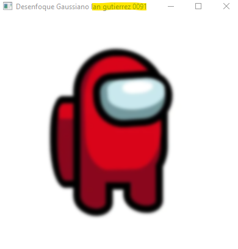
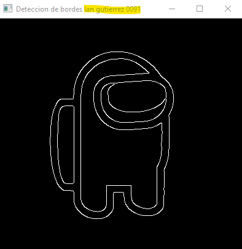
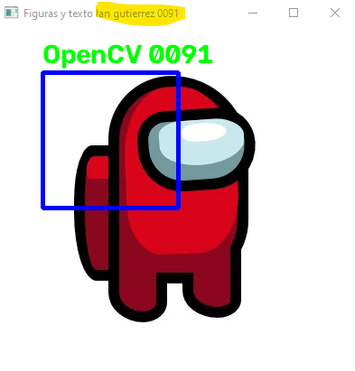
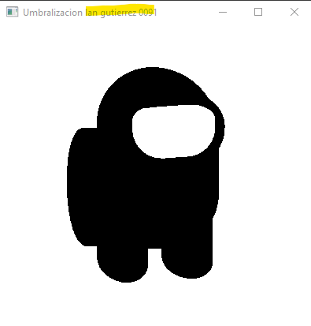
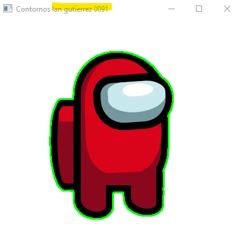
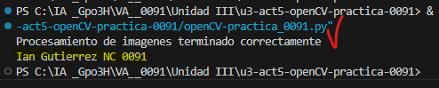

## Imagen original

## 1. Imagen gris 

## 2. Imagen redimensionada 

## 3. Imagen rotada 

## 4. Desenfoque Gaussiano 

## 5. Deteccion de bordes 

## 6. Figuras y texto 

## 7. Umbralizacion 

## 8. Contornos

## 9. Procesamiento de imagenes terminado correctamente
